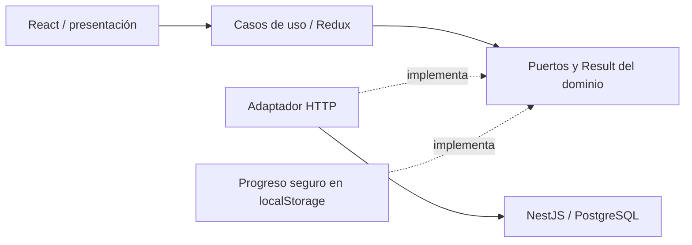

# blush-atelier-web

Frontend React de Blush Atelier. Repositorio independiente de [blush-atelier-api](https://github.com/blush-atelier/blush-atelier-api).

Funciona localmente: catálogo, búsqueda/filtros, detalle, carrito, formulario de entrega, resumen calculado por API, reserva `PENDING` y recuperación tras refrescar. El pago de prueba abre el Widget alojado de Wompi Sandbox. Requiere configurar las llaves únicamente en el backend; la validación con credenciales reales de Sandbox está pendiente.

## Iniciar en WSL

Requiere Node 22 (`nvm use`), dependencias del backend instaladas y su BD migrada/con productos. En una terminal:

```bash
cd /home/ana_analisis_algoritmos/repositorios/blush-atelier/blush-atelier-api
nvm use
docker compose up -d db
NODE_ENV=development POSTGRES_SSL=false npm run local:dev
```

Si ya tienes la API iniciada en el puerto 3000, conserva esa instancia. En otra terminal:

```bash
cd /home/ana_analisis_algoritmos/repositorios/blush-atelier/blush-atelier-web
nvm use
npm ci
npm run dev
```

Abre **http://localhost:5173**. API: http://localhost:3000/api/products. Swagger: http://localhost:3000/docs. Si tu BD aún no está preparada, ejecuta `POSTGRES_SSL=false npm run local:migrate` y `POSTGRES_SSL=false npm run local:seed` en el backend antes de iniciarlo. La configuración PostgreSQL pertenece al backend.

Vite envía `/api` al backend local mediante proxy: no necesitas `.env` en el frontend. Para otra API, copia `.env.example` a `.env` y configura `VITE_API_BASE_URL` con su origen, sin `/api`; reinicia Vite o reconstruye. Todo `VITE_*` es público: nunca poner contraseñas o claves privadas allí. Usa siempre el mismo host (`localhost`) durante la prueba.

## Qué probar

1. Explora Bases, Correctores, Sombras o Accesorios; busca y filtra por categoría o marca (MAC, Too Faced, Bloomshell, Atenea); entra al detalle y cambia la cantidad.
2. Pulsa **Agregar al carrito**. Agrega distintos productos desde la colección. Se abre una vista lateral sin salir del producto; puedes seguir comprando o pulsar Revisar carrito para cambiar unidades y eliminar líneas antes de continuar.
3. Pulsa **Continuar con la entrega**. El formulario vacío debe marcar errores; completa datos ficticios válidos. Elige Departamento y después Ciudad / municipio; cambiar departamento limpia la ciudad.
4. Revisa producto + tarifa base + envío en el resumen de dos capas (Backdrop). **Ver mis productos** despliega la selección (Ver mi producto si elegiste uno). Pulsa **Continuar con el pago**: crea primero `PENDING` y abre el Widget Wompi Sandbox. Elige tarjeta y utiliza solo datos oficiales de prueba. Al cerrarlo se consulta el resultado desde backend.
5. Refresca `/pedido`: se consulta el estado en API. Vuelve a la colección para ver el stock actualizado.
6. En DevTools prueba 320, 375, 768 y 1440 px; usa Tab y Escape en el modal. Desconecta la red y revisa el error/reintento.

El seed añade 20 productos de marcas reales con fotos optimizadas y precios de referencia en COP consultados el 13/11/2026; conserva los 2 productos ficticios anteriores. Stock de demostración. [Fuentes del catálogo](docs/decisions-and-interview-notes.md#mejora-visual-y-catálogo-real--13112026).

El catálogo tiene 22 productos, paginados de 8 en 8 (8/8/6). Página, búsqueda, categoría, marca y orden quedan en la URL; al cambiar filtros se vuelve a la primera página y el enlace Colección del detalle conserva la selección. La paginación actual es local sobre el listado de API.

El carrito admite **varios productos con cantidades independientes**. Cada reserva crea un solo pedido y aplica tarifa base/envío una sola vez. Agregar al carrito no reserva stock; solo se aparta al confirmar el resumen. Una solicitud pendiente o incierta bloquea cambios para evitar duplicados.

Montserrat y Bodoni Moda se sirven localmente (WOFF2, licencias OFL), sin consultas externas de fuentes. Los filtros usan Radix Select headless con estilos propios, teclado, portal y selección marcada. Las animaciones de carrito, cantidades y navegación móvil respetan reducir movimiento.

La reserva dura 15 minutos y depende de una sesión HttpOnly de una hora. La API libera reservas vencidas al consultar/cotizar/reservar; la pantalla actualiza el pedido cada 20 segundos cuando está visible. Solo se persisten referencias, cantidad y clave de reintento; contacto/dirección se mantienen en memoria del formulario. Una reserva no es un pago aprobado.

## Arquitectura y datos



`src/domain`: contratos, validaciones y dinero; `application`: flujo y estado seguro; `infrastructure`: HTTP/persistencia; `presentation`: páginas/componentes/CSS. Los importes viajan como strings de centavos y se formatean con `BigInt`, sin convertir a `Number`. El backend decide importes, stock y estado.

Modelo: productos/stock → líneas de transacción → transacciones; clientes → entregas/transacciones. Una transacción conserva sus productos, entrega, importes y reserva. [ERD](https://github.com/blush-atelier/blush-atelier-api/blob/development/docs/erd.mmd) y [diccionario](https://github.com/blush-atelier/blush-atelier-api/tree/development/docs) viven en el backend.

## Calidad

```bash
npm run format:check
npm run lint
npm run typecheck
npm run test:cov
npm run build
```

Jest: **126 pruebas**, 11 suites. Cobertura local medida: **96,69% statements · 94,06% branches · 98,07% functions · 96,91% lines**. El umbral es **81%** en statements, branches, functions y lines; incluye todo `src`, también el arranque. Reporte generado: `coverage/lcov-report/index.html` (no versionado).

CI ejecuta `npm ci` y todos los comandos anteriores en PR hacia development/staging/production y pushes a esas ramas o feature/*. La promoción es `feature/* → development → staging → production`; requiere configurar protecciones en GitHub. Workflow definido; ejecución remota pendiente. CD todavía no está habilitado.

Verificación visual en Chrome de Windows: los nueve tamaños solicitados, desde 320×568 hasta 1920×1080, con respuestas de API simuladas. [Evidencia y límites](docs/decisions-and-interview-notes.md#revisión-responsive-y-accesible-con-skills).

[Antes](docs/visual-review/before-375.webp) · [Después](docs/visual-review/after-375.webp) · [Selector abierto](docs/visual-review/brand-selector-375.webp) · [Checkout móvil](docs/visual-review/checkout-320.webp).

## Pago Sandbox y entrega pendiente

Configura Wompi en el `.env` del backend según su README y reinicia la API. No añadas
llaves Wompi al frontend. El Widget se carga desde su URL oficial cuando vas a pagar;
PAN/CVV se recogen allí. Redux/localStorage solo conservan progreso e ID de proveedor,
nunca sesión firmada, secretos ni tarjeta. No se instalaron dependencias nuevas.

Prueba aprobación/rechazo y cierre; al volver, Actualizar estado consulta nuestra API.
Si el resultado es incierto, conserva el mismo pedido. El ID del proveedor permite
reanudar la verificación después de F5 sin abrir otro pago. Para refrescar mientras
el Widget está abierto, configura un webhook HTTPS público accesible por Wompi;
localhost no sirve como destino del webhook. Un intento iniciado sin resultado
verificable mantiene la reserva hasta reconciliarse, no se libera por tiempo.

El flujo está probado con proveedor simulado; pendiente probarlo con tus credenciales
Sandbox, recibir eventos reales y verificar el despliegue AWS/HTTPS/CORS/cookies.
No se hicieron transacciones reales ni despliegues desde estos cambios.

[Requisitos](docs/requirements.md) · [Checklist](docs/acceptance-checklist.md) · [Decisiones y punto de retoma](docs/decisions-and-interview-notes.md)

[Auditoría de entrega y plan mínimo](../blush-atelier-api/docs/delivery-audit.md) (repositorio backend local).
