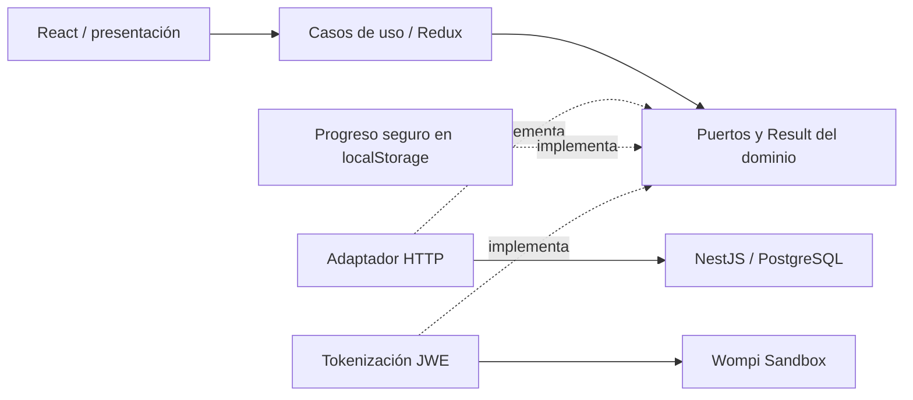

# blush-atelier-web

Frontend React de Blush Atelier. Repositorio independiente de [blush-atelier-api](https://github.com/blush-atelier/blush-atelier-api).

Funciona localmente: catálogo, búsqueda/filtros, detalle, carrito, formulario de entrega, resumen calculado por API, reserva `PENDING` y recuperación tras refrescar. El pago utiliza nuestro modal y tokenización cifrada directa con Wompi Sandbox. Configura las llaves únicamente en el backend. Aprobación y rechazo se verificaron contra UAT Sandbox mediante los adaptadores y API local; falta validar esta iteración en navegador y AWS.

## Iniciar en WSL

Requiere Node 22 (`nvm use`), dependencias del backend instaladas y su BD migrada/con productos. En una terminal:

```bash
cd /home/ana_analisis_algoritmos/repositorios/blush-atelier/blush-atelier-api
nvm use
docker compose up -d db
NODE_ENV=development POSTGRES_SSL=false npm run local:dev
```

Si ya tienes la API iniciada en el puerto 3000, conserva esa instancia. En otra terminal:

```bash
cd /home/ana_analisis_algoritmos/repositorios/blush-atelier/blush-atelier-web
nvm use
npm ci
npm run dev
```

Abre **http://localhost:5173**. API: http://localhost:3000/api/products. Swagger: http://localhost:3000/docs. Si tu BD aún no está preparada, ejecuta `POSTGRES_SSL=false npm run local:migrate` y `POSTGRES_SSL=false npm run local:seed` en el backend antes de iniciarlo. La configuración PostgreSQL pertenece al backend.

Vite envía `/api` al backend local mediante proxy: no necesitas `.env` en el frontend. Para otra API, copia `.env.example` a `.env` y configura `VITE_API_BASE_URL` con su origen, sin `/api`; reinicia Vite o reconstruye. Todo `VITE_*` es público: nunca poner contraseñas o claves privadas allí. Usa siempre el mismo host (`localhost`) durante la prueba.

## Qué probar

1. Explora Bases, Correctores, Sombras o Accesorios; busca y filtra por categoría o marca (MAC, Too Faced, Bloomshell, Atenea); entra al detalle y cambia la cantidad.
2. Pulsa **Agregar al carrito**. Agrega distintos productos desde la tienda. Se abre una vista lateral sin salir del producto; puedes seguir comprando o pulsar Revisar carrito para cambiar unidades y eliminar líneas antes de continuar.
3. Pulsa **Pagar con tarjeta de crédito**. Completa primero contacto y entrega y pulsa **Completar pago**. Después aparecen el resumen y la tarjeta: número, titular, vencimiento, CVC y dos aceptaciones de Wompi; el logo se detecta dentro del campo. Utiliza exclusivamente los datos oficiales de Sandbox. Elige Departamento y después Ciudad / municipio; cambiar departamento limpia la ciudad.
4. Revisa producto + tarifa base + envío en el resumen de dos capas (Backdrop). **Ver mis productos** despliega la selección (Ver mi producto si elegiste uno). Pulsa **Registrar pago**: crea primero `PENDING` y envía el token a nuestra API. Se activa **03 · Procesando pago** y se muestra **Completando pago** mientras se consulta el resultado verificado. Los avisos se abren en una ventana superior al checkout.
5. En **Mi pedido** puedes consultar una referencia de la sesión activa sin modificar el carrito. Refresca `/pedido`: se consulta el estado en API. Vuelve a la tienda para ver el stock actualizado.
6. En DevTools prueba 320, 375, 768 y 1440 px; usa Tab y Escape en el modal. Desconecta la red y revisa el error/reintento.

El seed añade 20 productos de marcas reales con fotos optimizadas y precios de referencia en COP consultados el 13/11/2026; conserva los 2 productos ficticios anteriores. Stock de demostración. [Fuentes del catálogo](docs/decisions-and-interview-notes.md#mejora-visual-y-catálogo-real--13112026).

El catálogo tiene 22 productos, paginados de 8 en 8 (8/8/6). Página, búsqueda, categoría, marca y orden quedan en la URL; al cambiar filtros se vuelve a la primera página y el enlace Tienda del detalle conserva la selección. La paginación actual es local sobre el listado de API.

El carrito admite **varios productos con cantidades independientes**. Cada reserva crea un solo pedido y aplica tarifa base/envío una sola vez. Agregar al carrito no reserva stock; solo se aparta al confirmar el resumen. Una solicitud pendiente o incierta bloquea cambios para evitar duplicados.

Montserrat y Bodoni Moda se sirven localmente (WOFF2, licencias OFL), sin consultas externas de fuentes. Los filtros usan Radix Select headless con estilos propios, teclado, portal y selección marcada. Las animaciones de carrito, cantidades y navegación móvil respetan reducir movimiento.

La reserva dura 15 minutos y depende de una sesión HttpOnly de una hora. La API libera reservas vencidas al consultar/cotizar/reservar; la pantalla actualiza el pedido cada 20 segundos cuando está visible. Solo se persisten referencias, cantidad y clave de reintento; contacto/dirección se mantienen en memoria del formulario. Una reserva no es un pago aprobado.

## Arquitectura y datos



`src/domain`: contratos, validaciones y dinero; `application`: flujo y estado seguro; `infrastructure`: HTTP/persistencia/tokenización; `presentation`: páginas/componentes/CSS. Los importes viajan como strings de centavos y se formatean con `BigInt`, sin convertir a `Number`. El backend decide importes, stock y estado.

Modelo: productos/stock → líneas de transacción → transacciones; clientes → entregas/transacciones. Una transacción conserva sus productos, entrega, importes y reserva. [ERD](https://github.com/blush-atelier/blush-atelier-api/blob/development/docs/erd.mmd) y [diccionario](https://github.com/blush-atelier/blush-atelier-api/tree/development/docs) viven en el backend.

## Calidad

```bash
npm run format:check
npm run lint
npm run typecheck
npm run test:cov
npm run build
```

Jest: **118 pruebas**, 11 suites. Cobertura local medida: **96,54% statements · 92,36% branches · 97,19% functions · 96,62% lines**. El umbral es **81%** en statements, branches, functions y lines; incluye todo `src`, también el arranque. Reporte generado: `coverage/lcov-report/index.html` (no versionado).

CI ejecuta `npm ci` y todos los comandos anteriores en PR hacia development/staging/production y pushes a esas ramas o feature/*. La promoción es `feature/* → development → staging → production`; requiere configurar protecciones en GitHub. Workflow definido; ejecución remota pendiente. CD todavía no está habilitado.

Revisión anterior (no acredita el nuevo formulario): en Chrome de Windows, los nueve tamaños solicitados, desde 320×568 hasta 1920×1080, con respuestas de API simuladas. [Evidencia y límites](docs/decisions-and-interview-notes.md#revisión-responsive-y-accesible-con-skills).

[Antes](docs/visual-review/before-375.webp) · [Después](docs/visual-review/after-375.webp) · [Selector abierto](docs/visual-review/brand-selector-375.webp) · [Checkout móvil](docs/visual-review/checkout-320.webp).

## Pago y seguridad

Configura Wompi en el `.env` del backend según su README y reinicia la API. El frontend
recibe solo configuración pública desde `/api/payments/card-configuration`; ya no usa
el Widget ni VITE_WOMPI_WIDGET_URL. No se instalaron dependencias nuevas.

El adaptador usa Web Crypto (JWE RSA-OAEP-256 + A256GCM) y envía la tarjeta cifrada
**directamente a Wompi**. Nuestra API recibe únicamente token, cuotas y aceptaciones.
PAN/CVC solo viven en el formulario; se limpian al iniciar el pago o cerrar. El token queda
fuera de Redux y localStorage y se descarta tras el envío. La tokenización no mueve
fondos: el cargo se pide después de revisar el resumen, completar la tarjeta y crear PENDING.

Con F5 no se recupera la tarjeta: si aún no se envió el pago, se solicita de nuevo.
Si ya se envió, se consulta el mismo pedido sin reenviar el cargo. Timeout no significa
rechazo. La API conserva la reserva hasta obtener un resultado verificado. Un intento
sin ID recuperable necesita el webhook HTTPS público, pendiente de configurar en AWS.

Pruebas oficiales: [tarjetas Sandbox](https://docs.wompi.co/docs/colombia/datos-de-prueba-en-sandbox/).
Las tarjetas aprobada/rechazada se comprobaron contra UAT, con base PostgreSQL aislada,
usando estos adaptadores desde Node; **no equivale a verificar el flujo en navegador**.
UAT rechazó una tercera tarjeta al tokenizar; ERROR se prueba con proveedor simulado.

La última revisión visual corresponde al diseño anterior. En esta iteración la herramienta
bloqueó el inicio de Chrome: faltan comprobar modal, alertas y menús renderizados a
320×568, 375×667, 390×844, 430×932, 768×1024, 1024×768, 1280×800, 1440×900 y 1920×1080,
y validar otros navegadores. También faltan webhook real y AWS/HTTPS/CORS/cookies.
No se hicieron pagos con dinero real, pushes, merges ni despliegues.

Logos Visa/Mastercard: [Simple Icons](https://github.com/simple-icons/simple-icons),
CC0; licencia junto a los SVG locales. Las marcas pertenecen a sus titulares.

[Requisitos](docs/requirements.md) · [Checklist](docs/acceptance-checklist.md).
