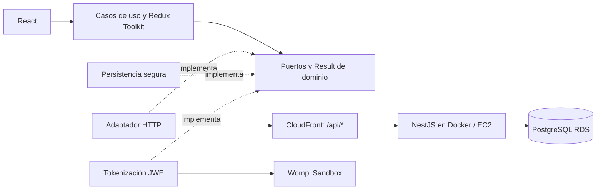

# Blush Atelier Web

Tienda de cosméticos desarrollada con React, TypeScript, Vite y Redux Toolkit.
Incluye catálogo, carrito, entrega, resumen de compra y pago con tarjeta mediante
Wompi Sandbox. El backend NestJS se mantiene en un repositorio independiente.

## Enlaces

| Servicio | URL                                                |
| -------- | -------------------------------------------------- |
| Tienda   | https://dviblid28pd4o.cloudfront.net/              |
| API      | https://blush-atelier-api.duckdns.org/api/products |
| Swagger  | https://dviblid28pd4o.cloudfront.net/api/docs      |
| OpenAPI  | https://dviblid28pd4o.cloudfront.net/api/docs-json |
| Backend  | https://github.com/blush-atelier/blush-atelier-api |

## Instalación y ejecución local

Requiere Node.js 22 (`.nvmrc`) y npm. Primero inicia PostgreSQL y la API siguiendo
el [README del backend](https://github.com/blush-atelier/blush-atelier-api#readme).
Después, desde la raíz de este repositorio:

```bash
nvm use
npm ci
npm run dev
```

Abre http://localhost:5173. Vite envía `/api` al backend local en el puerto 3000.
No se necesita `.env` para esta configuración.

### Configurar otra API

Copia `.env.example` a `.env` y configura `VITE_API_BASE_URL` con el origen de la
API, sin `/api`. Reinicia Vite o reconstruye después del cambio. En AWS se deja
vacío para utilizar `/api` en el mismo dominio CloudFront de la tienda.
Las variables `VITE_*` son públicas: no deben contener contraseñas ni secretos.
Las credenciales Wompi se configuran exclusivamente en el backend.

## Cómo probar la compra

1. Abre la tienda, filtra el catálogo y consulta el detalle de un producto.
2. Agrega uno o varios productos al carrito y revisa sus cantidades.
3. Pulsa **Pagar con tarjeta de crédito** y completa contacto y dirección.
   Elige primero departamento y después ciudad.
4. Pulsa **Completar pago**. Revisa productos, tarifa base y envío en el resumen.
5. Introduce una tarjeta de prueba, completa sus datos y acepta las condiciones.
   Solo se admiten Visa y Mastercard; el logo se detecta al escribir el número.
6. Pulsa **Registrar pago**. La aplicación muestra **03 · Procesando pago** mientras
   el backend verifica el resultado con Wompi.
7. Consulta el resultado y la referencia. Regresa a **Tienda** para comprobar el stock.

Usa únicamente los [datos oficiales de Wompi Sandbox](https://docs.wompi.co/docs/colombia/datos-de-prueba-en-sandbox/),
con vencimiento futuro y los datos ficticios indicados para ese ambiente. No uses
tarjetas reales. La tarifa total siempre se calcula en el backend.

| Caso                       | Comprobación esperada                                        |
| -------------------------- | ------------------------------------------------------------ |
| Compra aprobada            | Resultado APPROVED y stock actualizado                       |
| Compra rechazada           | Resultado DECLINED y stock físico conservado                 |
| Recargar durante el pago   | Se recupera el pedido y se consulta sin repetir el cargo     |
| Desconectar y reconectar   | Se informa el problema y se retoma la consulta del estado    |
| Doble clic en pagar        | No se genera un segundo cargo                                |
| Cantidad superior al stock | No permite continuar con una cantidad no disponible          |
| Datos inválidos            | Validación antes del envío, con mensajes junto al formulario |
| Sesión vencida             | Permite iniciar otra compra con una nueva sesión             |

El seguimiento del pedido es automático mientras está pendiente y visible.
No es necesario actualizar manualmente. Con una sesión activa, **Mi pedido** permite
consultar la referencia. Si el pago todavía no se envió, una recarga solicita
nuevamente la tarjeta: sus datos no se almacenan.

## Arquitectura



- `src/domain`: contratos, validaciones y representación de importes.
- `src/application`: casos de uso, acciones, reducers y estado de checkout.
- `src/infrastructure`: adaptadores HTTP, almacenamiento y tokenización.
- `src/presentation`: páginas, componentes, estilos y accesibilidad.

Redux sigue el flujo acciones → reducers → estado → interfaz. Los casos de uso
emplean `Result` para los fallos esperados. Los importes viajan como strings de
centavos y se formatean con `BigInt`; el backend decide precios, tarifas y stock.

[Modelo de datos y ERD](https://github.com/blush-atelier/blush-atelier-api#arquitectura-y-modelo-de-datos).

## Seguridad y diseño

El formulario cifra la tarjeta con JWE mediante Web Crypto y la envía directamente
a Wompi por HTTPS. PAN/CVC y el token de tarjeta no se guardan en Redux, localStorage
ni logs. El backend recibe únicamente el token y verifica el resultado del pago.
La persistencia local contiene solo referencias y progreso seguro del checkout.

El diseño utiliza CSS nativo, Grid/Flexbox, tipografías locales y layouts mobile-first.
Incluye navegación por teclado, foco visible, validaciones y movimiento reducido.
Los selectores utilizan Radix con estilos propios. Las licencias de fuentes y logos
se incluyen junto a sus archivos.

## Pruebas automatizadas

```bash
npm run format:check
npm run lint
npm run typecheck
npm run test:cov
npm run build
```

Jest: **139 pruebas, 13 suites**. Cobertura registrada: **96,88% sentencias,
92,66% ramas, 97,33% funciones y 96,81% líneas**. Umbral global: 81%.
Reporte generado en `coverage/lcov-report/index.html`.

## Build y despliegue

```bash
npm run build
npm run preview
```

El build se genera en `dist/`. El despliegue utiliza S3 y CloudFront; `/api/*` apunta
al backend HTTPS en EC2, conectado a PostgreSQL RDS. El frontend no contiene secretos
Wompi ni credenciales de base de datos.

## Limitaciones conocidas

- La emisión de webhooks reales desde Wompi no se confirmó por falta de acceso al
  dashboard. El receptor está probado con eventos simulados y el backend consulta
  el estado mediante la API privada para confirmar el pago.

[Requisitos](docs/requirements.md) ·
[Casos de prueba de API y stock](https://github.com/blush-atelier/blush-atelier-api/blob/development/docs/checkout-testing.md).
