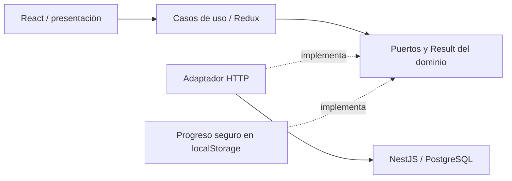

# blush-atelier-web

Frontend React de Blush Atelier. Repositorio independiente de [blush-atelier-api](https://github.com/blush-atelier/blush-atelier-api).

Funciona localmente: catálogo, búsqueda/filtros, detalle, formulario de entrega, resumen calculado por API, reserva `PENDING` y recuperación tras refrescar. **El pago con tarjeta todavía no está habilitado.** No se recogen tarjetas ni se hacen cobros.

## Iniciar en WSL

Requiere Node 22 (`nvm use`), dependencias del backend instaladas y su BD migrada/con productos. En una terminal:

```bash
cd /home/ana_analisis_algoritmos/repositorios/blush-atelier/blush-atelier-api
nvm use
docker compose up -d db
NODE_ENV=development POSTGRES_SSL=false npm run local:dev
```

Si ya tienes la API iniciada en el puerto 3000, conserva esa instancia. En otra terminal:

```bash
cd /home/ana_analisis_algoritmos/repositorios/blush-atelier/blush-atelier-web
nvm use
npm ci
npm run dev
```

Abre **http://localhost:5173**. API: http://localhost:3000/api/products. Swagger: http://localhost:3000/docs. Si tu BD aún no está preparada, ejecuta `POSTGRES_SSL=false npm run local:migrate` y `POSTGRES_SSL=false npm run local:seed` en el backend antes de iniciarlo. La configuración PostgreSQL pertenece al backend.

Vite envía `/api` al backend local mediante proxy: no necesitas `.env` en el frontend. Para otra API, copia `.env.example` a `.env` y configura `VITE_API_BASE_URL` con su origen, sin `/api`; reinicia Vite o reconstruye. Todo `VITE_*` es público: nunca poner contraseñas o claves privadas allí. Usa siempre el mismo host (`localhost`) durante la prueba.

## Qué probar

1. Explora Bases, Correctores, Sombras o Accesorios; busca y filtra por categoría o marca (MAC, Too Faced, Bloomshell, Atenea); entra al detalle y cambia la cantidad.
2. Prepara el pedido. El formulario vacío debe marcar errores; completa datos ficticios válidos.
3. Revisa producto + tarifa base + envío. Confirma la reserva: obtendrás referencia y estado `PENDING`.
4. Refresca `/pedido`: se consulta el estado en API. Vuelve a la colección para ver el stock actualizado.
5. En DevTools prueba 320, 375, 768 y 1440 px; usa Tab y Escape en el modal. Desconecta la red y revisa el error/reintento.

El seed añade 20 productos de marcas reales con fotos optimizadas y precios de referencia en COP consultados el 13/11/2026; conserva los 2 productos ficticios anteriores. Stock de demostración. [Fuentes del catálogo](docs/decisions-and-interview-notes.md#mejora-visual-y-catálogo-real--13112026).

El catálogo tiene 22 productos, paginados de 8 en 8 (8/8/6). Página, búsqueda, categoría, marca y orden quedan en la URL; al cambiar filtros se vuelve a la primera página y el enlace Colección del detalle conserva la selección. La paginación actual es local sobre el listado de API.

La reserva dura 15 minutos y depende de una sesión HttpOnly de una hora. La API libera reservas vencidas al consultar/cotizar/reservar; la pantalla actualiza el pedido cada 20 segundos cuando está visible. Solo se persisten referencias, cantidad y clave de reintento; contacto/dirección se mantienen en memoria del formulario. Una reserva no es un pago aprobado.

## Arquitectura y datos



`src/domain`: contratos, validaciones y dinero; `application`: flujo y estado seguro; `infrastructure`: HTTP/persistencia; `presentation`: páginas/componentes/CSS. Los importes viajan como strings de centavos y se formatean con `BigInt`, sin convertir a `Number`. El backend decide importes, stock y estado.

Modelo: productos/stock → transacciones, clientes → entregas/transacciones. Una transacción conserva producto, entrega, importes y reserva. [ERD](https://github.com/blush-atelier/blush-atelier-api/blob/development/docs/erd.mmd) y [diccionario](https://github.com/blush-atelier/blush-atelier-api/tree/development/docs) viven en el backend.

## Calidad

```bash
npm run format:check
npm run lint
npm run typecheck
npm run test:cov
npm run build
```

Jest: **82 pruebas**, 7 suites. Cobertura local medida: **97,63% statements · 96,93% branches · 97,87% functions · 97,56% lines**. El umbral es **81%** en statements, branches, functions y lines; incluye todo `src`, también el arranque. Reporte generado: `coverage/lcov-report/index.html` (no versionado).

CI ejecuta `npm ci` y todos los comandos anteriores en PR hacia development/staging/production y pushes a esas ramas o feature/*. La promoción es `feature/* → development → staging → production`; requiere configurar protecciones en GitHub. Workflow definido; ejecución remota pendiente. CD todavía no está habilitado.

## Entrega pendiente

Wompi Sandbox: captura alojada/tokenizada, inicio de pago, verificación en backend, webhook e idempotencia del pago; luego E2E Sandbox. AWS: S3/CloudFront, HTTPS, fallback SPA y API conectada; configurar origen permitido/cookies y OIDC tras validar infraestructura. URLs públicas frontend/API/Swagger: **pendientes de verificar**. No se han desplegado recursos desde este cambio.

[Requisitos](docs/requirements.md) · [Checklist](docs/acceptance-checklist.md) · [Decisiones y punto de retoma](docs/decisions-and-interview-notes.md)
