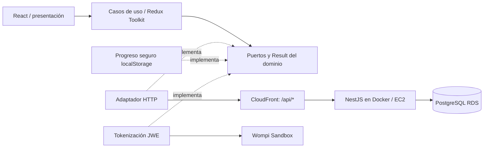

# Blush Atelier Web

Tienda de cosméticos mobile-first: React, TypeScript, Vite y Redux Toolkit.
Repositorio independiente del backend NestJS. Pagos exclusivamente Wompi Sandbox.

| Entrega          | URL                                                                     |
| ---------------- | ----------------------------------------------------------------------- |
| Tienda publicada | [Blush Atelier](https://dviblid28pd4o.cloudfront.net/)                  |
| API pública      | [Catálogo JSON](https://dviblid28pd4o.cloudfront.net/api/products)      |
| Origen API HTTPS | [API NestJS](https://blush-atelier-api.duckdns.org)                     |
| Swagger          | [API interactiva](https://dviblid28pd4o.cloudfront.net/api/docs)        |
| Frontend         | [blush-atelier-web](https://github.com/blush-atelier/blush-atelier-web) |
| Backend          | [blush-atelier-api](https://github.com/blush-atelier/blush-atelier-api) |

## Ejecutar localmente

Requiere Node 22 (`.nvmrc`). Primero inicia el backend con PostgreSQL migrado y seed,
siguiendo su [README](https://github.com/blush-atelier/blush-atelier-api#readme).
Desde la raíz de este repositorio:

```bash
nvm use
npm ci
npm run dev
```

Abre http://localhost:5173. Vite envía `/api` a http://127.0.0.1:3000 mediante proxy;
no se necesita `.env` para el desarrollo habitual. Conserva el mismo host del navegador.

Para otra API, copia `.env.example` a `.env` y define `VITE_API_BASE_URL` con su origen,
sin `/api`. Reinicia Vite o reconstruye: las variables se incorporan durante el build.
En AWS se usa el mismo origen web/API, por lo que se deja vacío. Todo `VITE_*` es
público; nunca pongas llaves privadas, secretos Wompi ni contraseñas aquí.

## Flujo de compra

1. Explora catálogo, busca/filtra por categoría o marca y abre el detalle con stock.
2. Agrega productos al carrito, revisa unidades y pulsa **Pagar con tarjeta de crédito**.
3. Completa **01 Tus datos**, contacto y entrega; departamento habilita las ciudades.
4. **02 Resumen y tarjeta** muestra productos + tarifa base + envío en Backdrop.
   Completa tarjeta y aceptaciones; se detecta Visa/Mastercard dentro del campo.
5. **Registrar pago** tokeniza en Wompi, crea PENDING en nuestra API antes del cargo
   y abre **03 Procesando pago** hasta recibir el estado verificado por el backend.
6. Consulta el resultado/referencia y vuelve a **Tienda** con stock actualizado.

El carrito admite varios productos y las tarifas se aplican una sola vez. Agregar
productos no reserva: la reserva ocurre al crear PENDING. La aplicación consulta
cada 2,5 segundos mientras el pedido está pendiente y visible, y al recuperar
conexión/foco. Recargar restaura referencias seguras y consulta la API sin repetir cargos.
Una sesión vencida permite iniciar otra selección sin recuperar permisos del pedido viejo.

Usa únicamente [tarjetas oficiales Sandbox](https://docs.wompi.co/docs/colombia/datos-de-prueba-en-sandbox/).
La [guía del backend](https://github.com/blush-atelier/blush-atelier-api/blob/development/docs/checkout-testing.md)
explica aprobación, rechazo, recarga, stock, duplicados y comprobaciones SQL.

## Arquitectura y seguridad



`domain`: contratos, validaciones y dinero; `application`: casos de uso, acciones y
estado Redux; `infrastructure`: adaptadores HTTP, almacenamiento y tokenización;
`presentation`: páginas, componentes y CSS. Redux sigue Flux: acciones → reducers
→ estado → UI. Los fallos esperados usan `Result`, sin reglas de pago en componentes.

Importes en strings de centavos, cálculos/formato con `BigInt`. El backend decide
precio, tarifas, disponibilidad y resultado. [Modelo PostgreSQL y ERD](https://github.com/blush-atelier/blush-atelier-api#arquitectura-y-modelo-de-datos).

Número/CVC solo viven en memoria del formulario, se cifran con JWE mediante Web Crypto
y viajan directamente a Wompi por HTTPS. El token es efímero; no se guarda en Redux,
localStorage ni logs. La API recibe el token, nunca la tarjeta. Se persisten solo
referencias y progreso seguro; contacto y dirección permanecen en memoria.
[Seguridad de pagos](https://github.com/blush-atelier/blush-atelier-api/blob/development/docs/payment-security.md).

CSS nativo con Grid/Flexbox, tokens y estilos por responsabilidad. Tipografías
Montserrat/Bodoni Moda locales con licencias OFL; selectores accesibles con Radix.
Imágenes con dimensiones, carga diferida y fallback; microinteracciones respetan
`prefers-reduced-motion`. Logos Visa/Mastercard de Simple Icons, CC0; licencias locales.

## Calidad

```bash
npm run format:check
npm run lint
npm run typecheck
npm run test:cov
npm run build
```

Última medición: **139 pruebas, 13 suites**. Cobertura Jest:
**96,88% sentencias · 92,66% ramas · 97,33% funciones · 96,81% líneas**.
Umbral global 81% en las cuatro métricas; incluye todo `src`.
Reporte local: `coverage/lcov-report/index.html` (no versionado).

La usuaria confirmó el ciclo de compra y el responsive de la versión actual.
Las capturas en `docs/visual-review/` corresponden a una revisión anterior: no prueban
el modal actual. La usuaria confirmó dos compras Sandbox en AWS. Sigue pendiente evidencia de pruebas
con Firefox/Safari; no se dan por verificadas pantallas que la herramienta no observó.

## AWS y CI

`npm run build` genera `dist/` para S3 y CloudFront. El comportamiento `/api/*` debe
apuntar al backend y el resto a S3. Configura recuperación de rutas SPA (`/carrito`,
`/pedido`, detalle) sin transformar errores de API en HTML. Conserva `.env`/secretos
fuera de `dist/`; configura cabeceras de seguridad en CloudFront y caché de assets.
No publiques ni invalides caché sin aprobar el despliegue.

GitHub Actions ejecuta `npm ci`, formato, lint, typecheck, Jest con cobertura y build.
Promoción por PR: `feature/* → development → staging → production`. No hay despliegue
automático. CI/CD es un valor agregado, no un requisito de la rúbrica.

### Limitaciones conocidas

Las dos compras Sandbox en AWS fueron comprobadas por la usuaria. El webhook público
rechaza firma inválida; eventos firmados, duplicados y rollback se validaron con
proveedor simulado. No se comprobó un webhook emitido por Wompi: el dashboard
compartido está bloqueado. El backend confirma el estado mediante consulta privada.
Firefox/Safari no se probaron; no se declara compatibilidad verificada.

CloudFront aún convierte globalmente errores 403/404 en `index.html` con HTTP 200,
incluso para `/api/*`. La API directa conserva el 404 JSON. La corrección pendiente
es reescribir únicamente rutas SPA en el comportamiento S3 y retirar el fallback
global; no se aplicaron cambios AWS. [Requisitos](docs/requirements.md).
